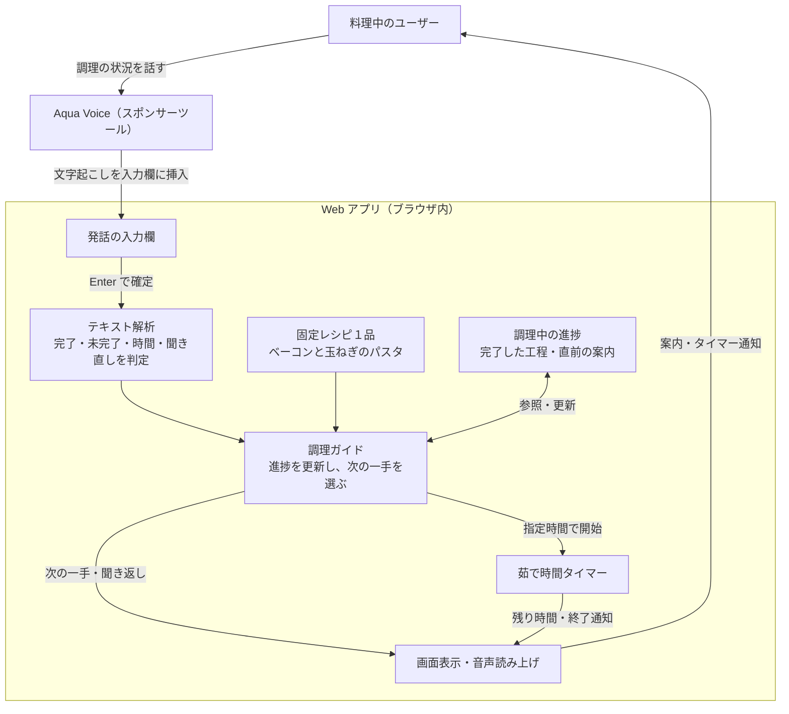

# 料理の音声ガイド（仮）

AIhack 2026「話すだけで誰かの面倒を減らすアプリ」の企画です。

一人暮らしの会社員が、料理中に「お湯は沸いた。玉ねぎは切った。ベーコンはまだ」と話すと、アプリがレシピの進み具合を更新し、次にやることを一つだけ読み上げます。手が濡れていても、スマホを触ってレシピの続きを探す手間が減ります。

## ハッカソンで作る範囲

対象レシピは「ベーコンと玉ねぎのパスタ」１品です。「料理を始める」を押したら、盛り付けまで声で進められる体験を作ります。

- **進み具合の更新** — 音声から済んだ工程を拾い、まだの工程を残す。
- **次の一手の読み上げ** — 今できる工程を一つ案内する。「できた」で進み、「もう一回」で繰り返す。曖昧なときは聞き返す。
- **茹で時間のタイマー** — パスタを入れた報告と指定時間で計測を始める。計測中も具材の準備を案内し、時間が来たら声で知らせる。

画面には材料、開始ボタン、調理中の案内、タイマーの残り時間を表示します。

## デモの流れ

1. 材料を確認して「料理を始める」を押す。
2. 「お湯は沸いた。玉ねぎは切った。ベーコンはまだ」と話す。アプリは済んだ工程を飛ばし、パスタを入れるよう案内する。
3. 「パスタを入れた。７分」と話す。アプリはタイマーを始め、茹でている間にベーコンを切るよう案内する。
4. 「ベーコン切った」と話すと、ベーコンと玉ねぎを炒める工程に進む。炒め終えたら火を止める。
5. タイマーが鳴ったら茹で具合を確認する。「湯を切った」と話すと、パスタを具材と混ぜて味を整えるよう案内する。
6. 「味付けできた」と話すと、盛り付けを案内して完了する。

## システム構成

音声入力には、スポンサーツールの [Aqua Voice](https://aquavoice.com/guide) を使います。Aqua Voice が文字起こしを Web アプリの入力欄に挿入し、ユーザーが Enter で確定します。アプリ側は、静的ホスティングで配信する１人用の Web アプリです。発話の判定、進捗の管理、タイマーはブラウザ内で動きます。

試作では、レシピ１品に合わせたルールでテキストを判定し、進捗は調理中のページ内に保持します。ログイン、データベース、独自 API は不要です。

## ２人の役割分担

| 担当 | 作るもの | 完成条件 |
| --- | --- | --- |
| A｜画面・音声・タイマー | 開始ボタン、発話入力欄、案内の表示と読み上げ、タイマーの計測と終了通知。デモ端末での Aqua Voice の設定と、静的サイトの公開も担当する。 | Aqua Voice で入力して Enter を押すと案内が表示され、読み上げられる。タイマー終了も声で分かる。 |
| B｜レシピ・発話の判定・進捗 | パスタ１品の工程データ、完了・未完了・茹で時間の判定、次の工程の選択。「できた」「もう一回」や曖昧な発話にも対応する。 | 「お湯は沸いた。玉ねぎは切った。ベーコンはまだ」で済んだ工程を飛ばせる。「入れた。７分」で次の案内とタイマー開始の指示を返せる。 |

A は確定したテキストと現在の進捗を B の調理ロジックに渡します。B は更新後の進捗、案内文、タイマー開始の指示があればその時間を返します。「入れた。７分」なら、A が「ベーコンを切りましょう」と読み上げ、７分の計測を始めます。

最初に２人で受け渡す項目とデモで使う発話を揃えます。A は仮の返答で画面を作り、B はテキストだけで工程判定を試します。接続後はデモ端末で開始から盛り付けまで通し、茹でている間も案内が進み、次の発話を待たずにタイマー終了を知らせることを確認します。

## 開発状況

企画段階です。上記は試作の予定です。
