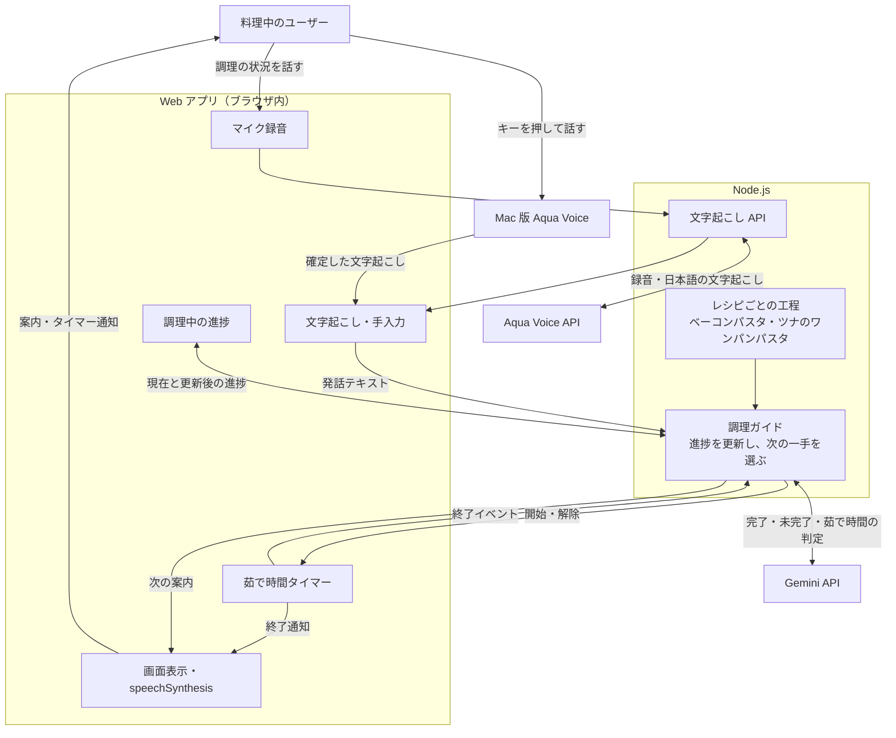

# ミミシェフ

**声で進める料理ガイド**

AIhack 2026「話すだけで誰かの面倒を減らすアプリ」の企画です。

一人暮らしの会社員が、料理中に「お湯は沸いた。玉ねぎは切った。ベーコンはまだ」と話すと、アプリがレシピの進み具合を更新し、次にやることを一つだけ読み上げます。手が濡れていても、スマホを触ってレシピの続きを探す手間が減ります。

## ハッカソンで作る範囲

対象レシピは「ベーコンと玉ねぎのパスタ」と「ツナ缶と玉ねぎのワンパンパスタ」です。「料理を始める」を押したら、盛り付けまで声で進められる体験を作ります。

- **進み具合の更新** — 音声から済んだ工程を拾い、まだの工程を残す。
- **次の一手の読み上げ** — 今できる工程を一つ案内する。「できた」で進み、「もう一回」で繰り返す。曖昧なときは聞き返す。「火加減は？」「何センチに切る？」「焼き加減は？」には、今の手順に合わせて答える。
- **茹で時間のタイマー** — パスタを入れた報告と指定時間で計測を始める。計測中も具材の準備を案内し、時間が来たら声で知らせる。「あと何分？」と聞くと、残り時間を読み上げる。時間が来てから湯切りする前に「あと1分茹でる」と話すと、追加のタイマーが始まる。

画面には材料、開始ボタン、調理中の案内、タイマーの残り時間を表示します。

## デモの流れ

1. 材料を確認して「料理を始める」を押す。
2. 「お湯は沸いた。玉ねぎは切った。ベーコンはまだ」と話す。アプリは済んだ工程を飛ばし、パスタを入れるよう案内する。
3. 「パスタを入れた。７分」と話す。アプリはタイマーを始め、茹でている間にベーコンを切るよう案内する。
4. 「ベーコン切った」と話すと、ベーコンと玉ねぎを炒める工程に進む。炒め終えたら火を止める。
5. タイマーが鳴ったら茹で具合を確認する。「湯を切った」と話すと、パスタを具材と混ぜて味を整えるよう案内する。
6. 「味付けできた」と話すと、盛り付けを案内して完了する。

## 試せる機能

- **すぐに料理する**。鍋とフライパンで作るベーコンパスタか、深めのフライパン１つで作るツナパスタを選べます。
- **食材・道具を確認する**。食材ごとに「ある・ない」または数量を選べます。在庫と道具から提案されたレシピを選ぶか、別のレシピに切り替えられます。必要な食材を買い出しリストに追加し、賞味期限・消費期限を記録できます。在庫を使って料理した場合は、盛り付け後に実際の使用量を確認して更新できます。

### モバイル版のプレビュー

Node.js 22 以上で、リポジトリのルートから `npm run preview:mobile` を実行し、[モバイル版](http://127.0.0.1:3135/) を開きます。文字入力の返答には `GEMINI_API_KEY`、会話モードの文字起こしには `AQUA_API_KEY` を、`.env.example` を参考に `.env` に設定してください。

キーを別のローカルファイルに保存している場合は、起動時にそのファイルを指定できます。設定を変更したらプレビューサーバーを再起動します。

```sh
node --env-file="$HOME/.config/ai-hack-2026/demo.env" mobile-design-mock/preview-server.js
```

`音声で料理を始める` を選ぶと、マイクの許可後に最初の案内を読み上げて会話を始めます。`文字で始める` は入力欄を開きます。調理中の報告、相談への答え、次の工程は一つの会話に順番に並びます。画面下の操作バーからいつでも会話の開始・停止や文字入力に切り替えられます。

最初の案内、次の工程、質問への答え、聞き返し、タイマーの開始・終了、調理完了を日本語で読み上げます（Gemini TTS の Callirrhoe）。文字で入力したときも読み上げます。会話モードでは、発話後の短い無音で自動送信し、読み上げ後に聞き取りを再開します。茹で時間が終わると短い音と声で知らせます。音声を生成できない場合はブラウザーの読み上げを使います。

読み上げ中や返答を待っているときは、`今すぐ話す` で現在の案内を止め、次の発話を聞き取れます。「もう一回」で現在の案内を読み直します。手順が明確な完了報告や「何センチに切ればいい？」などの決まった質問は、その場で処理します。

### 画面確認用デモ

リポジトリのルートで以下を実行し、[デモ画面](http://127.0.0.1:3001/?demo=1)を開きます。画面確認用デモは API キーなしでも使えます。

```sh
npm start
```

調理状況を文字で入力します。「デモ用タイマー（最長10秒）」を使うと、終了の読み上げまで短時間で確認できます。

### 発表で Mac 版 Aqua Voice を使う

発表では Mac 版 Aqua Voice の入力モードを Instant にし、「Aqua Voice の入力を自動送信」をオンにします。入力欄にカーソルを置き、Aqua Voice のキーを押しながら話すと、キーを離したときに入力された文が自動で送信されます。自動送信が反応しない場合や、文字を直してから送る場合は「送信」または Enter を使えます。この手順ではアプリに `AQUA_API_KEY` の設定は不要です。

- [通常画面](http://127.0.0.1:3001/) では `GEMINI_API_KEY` を設定すると、確定した発話から調理の進み具合を判定します。
- [画面確認用デモ](http://127.0.0.1:3001/?demo=1) では用意した発話に応答するため、API キーなしで発表の流れを練習できます。

最初に「お湯は沸いた。玉ねぎは切った。ベーコンはまだ」と話し、パスタを入れる案内が返ることを確かめます。終了通知まで短時間で見せる場合は、動作確認用として「パスタを入れた。10秒」と話します。

### Aqua Voice API と Gemini を使う

Node.js 22 以上を使います。`.env.example` を参考に `.env` に `AQUA_API_KEY` と `GEMINI_API_KEY` を設定し、`npm start` を実行します。[通常画面](http://127.0.0.1:3001/) で「すぐに料理する」から会話モードを開始できます。Aqua Voice が文字起こしし、Gemini が判定した結果をもとに画面が案内を読み上げます。文字での送信も使えます。

画面確認用デモの最初の案内は、収録済みの Gemini TTS 音声（Callirrhoe）で読み上げます。Gemini API キーがある場合は、ほかの案内とタイマー通知も同じ音声で読み上げます。キーが未設定の場合や音声を生成できない場合は、ブラウザーの読み上げを使います。

### 会話モード

Aqua Voice API と Gemini のキーを設定した通常画面で、調理を始めてから「会話を始める」を選び、ブラウザのマイクを許可します。「聞いています。」の表示が出たら、調理の状況を話してください。発話後の短い無音で自動送信し、読み上げが終わると次の発話を待ちます。

「会話を止める」、調理完了、または別のタブへの切り替えでマイクの使用を終了します。会話を止めると、Mac 版 Aqua Voice の自動送信に切り替えられます。会話モードは発話単位で処理します。

## システム構成

音声入力には、スポンサーツールの [Aqua Voice API](https://aquavoice.com/docs/api) を使います。API キーは Node.js の環境変数で管理します。



画面確認用デモでは固定の応答を使います。通常画面では発話を Gemini で判定し、固定レシピから次の案内を選びます。タイマーはブラウザで動き続け、在庫は同じブラウザに保存されます。

## ２人の役割分担

| 担当 | 作るもの | 完成条件 |
| --- | --- | --- |
| A｜画面・音声・タイマー | 開始画面、音声入力、表示と読み上げ、タイマー、食材・道具、買い出し、期限の画面。 | 発話を終えると案内が読み上げられる。タイマー終了も声で分かる。 |
| B｜レシピ・発話の判定・進捗 | パスタの工程データ、Aqua Voice と Gemini への接続、進捗更新と次の工程の選択。 | 「お湯は沸いた。玉ねぎは切った。ベーコンはまだ」で済んだ工程を飛ばせる。「入れた。７分」で次の案内とタイマー開始の指示を返せる。 |

A は確定したテキストと現在の進捗を B の調理ロジックに渡します。B は更新後の進捗、案内文、タイマー開始の指示があればその時間を返します。「入れた。７分」なら、A が「ベーコンを切りましょう」と読み上げ、７分の計測を始めます。

最初に２人で受け渡す項目とデモで使う発話を揃えます。A は仮の返答で画面を作り、B はテキストだけで工程判定を試します。接続後はデモ端末で開始から盛り付けまで通し、茹でている間も案内が進み、次の発話を待たずにタイマー終了を知らせることを確認します。

## 開発状況

画面確認用デモで、食材と道具の選択、読み上げ、タイマー表示、調理後の在庫更新を試せます。通常画面では選択したレシピを Aqua Voice と Gemini で案内します。入出力は [A・B 接続仕様](./pantry-integration.md) を参照してください。


## 今後の展望

換気扇や調理音のある環境でも、発話の終わりを安定して検出したいと考えています。聞き取りが曖昧なときは、進捗やタイマーを確定する前に聞き返す場面を増やします。
