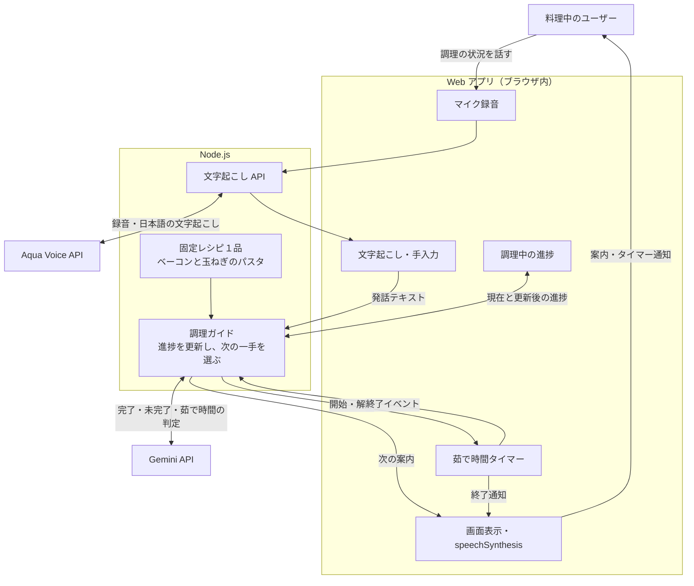

# つぎ、なにする？

**声で進める料理ガイド**

AIhack 2026「話すだけで誰かの面倒を減らすアプリ」の企画です。

一人暮らしの会社員が、料理中に「お湯は沸いた。玉ねぎは切った。ベーコンはまだ」と話すと、アプリがレシピの進み具合を更新し、次にやることを一つだけ読み上げます。手が濡れていても、スマホを触ってレシピの続きを探す手間が減ります。

## ハッカソンで作る範囲

対象レシピは「ベーコンと玉ねぎのパスタ」１品です。「料理を始める」を押したら、盛り付けまで声で進められる体験を作ります。

- **進み具合の更新** — 音声から済んだ工程を拾い、まだの工程を残す。
- **次の一手の読み上げ** — 今できる工程を一つ案内する。「できた」で進み、「もう一回」で繰り返す。曖昧なときは聞き返す。
- **茹で時間のタイマー** — パスタを入れた報告と指定時間で計測を始める。計測中も具材の準備を案内し、時間が来たら声で知らせる。

画面には材料、開始ボタン、調理中の案内、タイマーの残り時間を表示します。

## デモの流れ

1. 材料を確認して「料理を始める」を押す。
2. 「お湯は沸いた。玉ねぎは切った。ベーコンはまだ」と話す。アプリは済んだ工程を飛ばし、パスタを入れるよう案内する。
3. 「パスタを入れた。７分」と話す。アプリはタイマーを始め、茹でている間にベーコンを切るよう案内する。
4. 「ベーコン切った」と話すと、ベーコンと玉ねぎを炒める工程に進む。炒め終えたら火を止める。
5. タイマーが鳴ったら茹で具合を確認する。「湯を切った」と話すと、パスタを具材と混ぜて味を整えるよう案内する。
6. 「味付けできた」と話すと、盛り付けを案内して完了する。

## 試せる機能

- **すぐに料理する**。通常モードでは、ベーコンと玉ねぎのパスタを鍋とフライパンで作ります。ツナとワンパンの組み合わせは画面確認用デモで試せます。
- **食材・道具を確認する**。食材ごとに「ある・ない」または数量を選べます。必要な食材を買い出しリストに追加し、賞味期限・消費期限を記録できます。在庫を使って料理した場合は、盛り付け後に実際の使用量を確認して更新できます。

### 画面確認用デモ

リポジトリのルートで以下を実行し、[デモ画面](http://127.0.0.1:3001/?demo=1)を開きます。画面確認用デモは API キーなしでも使えます。

```sh
npm start
```

調理状況を文字で入力します。「デモ用タイマー（最長10秒）」を使うと、終了の読み上げまで短時間で確認できます。

### Aqua Voice API と Gemini を使う

Node.js 22 以上を使います。`.env.example` を参考に `.env` に `AQUA_API_KEY` と `GEMINI_API_KEY` を設定し、`npm start` を実行します。[通常画面](http://127.0.0.1:3001/) で「すぐに料理する」から「録音する」を押して話し、録音を止めます。Aqua Voice が文字起こしし、Gemini が判定した結果をもとに画面が案内を読み上げます。文字での送信も使えます。

## システム構成

音声入力には、スポンサーツールの [Aqua Voice API](https://aquavoice.com/docs/api) を使います。API キーは Node.js の環境変数で管理します。



画面確認用デモでは固定の応答を使います。通常画面では発話を Gemini で判定し、固定レシピから次の案内を選びます。タイマーはブラウザで動き続け、在庫は同じブラウザに保存されます。

## ２人の役割分担

| 担当 | 作るもの | 完成条件 |
| --- | --- | --- |
| A｜画面・音声・タイマー | 開始画面、録音操作、表示と読み上げ、タイマー、食材・道具、買い出し、期限の画面。 | 録音を止めると案内が読み上げられる。タイマー終了も声で分かる。 |
| B｜レシピ・発話の判定・進捗 | パスタの工程データ、Aqua Voice と Gemini への接続、進捗更新と次の工程の選択。 | 「お湯は沸いた。玉ねぎは切った。ベーコンはまだ」で済んだ工程を飛ばせる。「入れた。７分」で次の案内とタイマー開始の指示を返せる。 |

A は確定したテキストと現在の進捗を B の調理ロジックに渡します。B は更新後の進捗、案内文、タイマー開始の指示があればその時間を返します。「入れた。７分」なら、A が「ベーコンを切りましょう」と読み上げ、７分の計測を始めます。

最初に２人で受け渡す項目とデモで使う発話を揃えます。A は仮の返答で画面を作り、B はテキストだけで工程判定を試します。接続後はデモ端末で開始から盛り付けまで通し、茹でている間も案内が進み、次の発話を待たずにタイマー終了を知らせることを確認します。

## 開発状況

画面確認用デモで、食材と道具の選択、読み上げ、タイマー表示、調理後の在庫更新を試せます。通常画面ではベーコンと玉ねぎのパスタを Aqua Voice と Gemini で案内します。入出力は [A・B 接続仕様](./pantry-integration.md) を参照してください。
