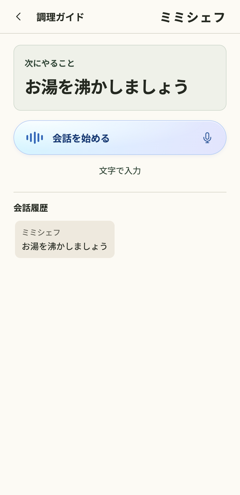

# 【AI HACK 2026】「玉ねぎは切った」と話すと、次の手順を教えてくれるミミシェフを作った

AI HACK SPECIAL ONE-DAY HACKATHONで、チーム「ギャップ」として、声で進める料理ガイド「ミミシェフ」を作りました。課題は「話すだけで誰かの面倒を減らすアプリ」。私たちが選んだのは、一人暮らしの会社員が料理中にレシピの続きを探す手間です。

## 手が濡れているときに、レシピを探したくない

パスタを作っていると、お湯を沸かしながら玉ねぎを切ることがあります。具材を先に切った日もあれば、切るのが後になる日もあります。そのたびに手を拭いてスマホに戻り、どこまで済んだかを探すのは面倒です。

そこで、進み具合を普段の言葉で伝えると、済んだ工程を飛ばして、次にやることを一つ読み上げるようにしました。

| 話したこと | ミミシェフの反応 |
| --- | --- |
| お湯は沸いた。玉ねぎは切った。ベーコンはまだ。 | お湯と玉ねぎの工程を済みにして、パスタを入れるよう案内する |
| パスタを入れた。7分。 | タイマーを始め、茹でている間にベーコンを1cm幅に切るよう案内する |
| あと何分？ | 残り時間を読み上げる。調理の進み具合はそのまま |
| まだ硬い。 | 「あと何分茹でますか？」と聞く。時間を答えると追加タイマーを始める |

時間だけ聞こえた場合は、「7分ですね。パスタはもう入れましたか？」と聞き返します。入れる前にパッケージを読んだだけでも、タイマーが勝手に始まらないようにしました。

## スマホで使うときの画面




調理中は、今やることと残り時間を近くに置きました。音声を聞きそびれたときは、画面を一目見れば続きが分かります。画像はモバイル向けデザインのプレビューです。日本語の本文、ボタン、調理の指示には Noto Sans JP を使用しています。

## 声をどう処理したか

ブラウザの会話モードでは、発話の後に短い無音を検出して音声を送り、[Aqua Voice API](https://aquavoice.com/docs/api)で文字起こしします。Geminiには、選んだレシピと現在の進み具合を渡し、発話の中で完了・未完了になった工程と指定された時間を返してもらいます。次の手順とタイマーの状態は、レシピデータと進捗を見てアプリが決めます。「あと何分？」や「火加減は？」のように手元の情報で答えられる質問は、ブラウザで答えます。

会話モードは、案内を読み上げている間は聞き取りを休み、読み上げが終わると再開します。Mac版のAqua Voiceで入力欄に話す場合は、Instantで確定した文字を自動送信する設定も用意しました。

## 冷蔵庫にベーコンがなければ

ベーコンと玉ねぎのパスタに加え、ツナ缶と玉ねぎのワンパンパスタも選べます。ベーコンがなく、ツナ缶と深めのフライパンがあれば、食材・道具の画面からワンパンパスタを提案します。レシピごとに工程が異なるので、ワンパンのタイマーが終わったら、湯切りではなく火を止める案内を出します。盛り付けたあとに実際に使った量を確認してから、在庫を更新できます。

私は主に、調理画面と音声入力・案内、タイマーまわりを担当しました。短い発話への聞き返しを実装してみて、音声入力の手間を減らすには、聞き取れなかったときに会話をどう続けるかも大切だと分かりました。

## 試す

[GitHubのリポジトリ](https://github.com/bomkim-dev/ai-hack-2026)を取得し、Node.js 22以上で以下を実行します。

```sh
npm start
```

[画面確認用デモ](http://127.0.0.1:3001/?demo=1)は、APIキーなしで文字入力とタイマーを試せます。通常画面で会話モードを使うときは、READMEに沿ってAqua VoiceとGeminiのAPIキーを設定します。自動テストでは、聞き返し、タイマー、レシピ選択、使用量の確認後にツナ缶が一度だけ減ることを確認しました。外部APIの応答を模擬した検証も含みます。

[AI HACK SPECIAL ONE-DAY HACKATHON](https://aihackathon.jp/special/1123/)に参加する機会をつくってくださった運営の皆さま、ありがとうございました。
