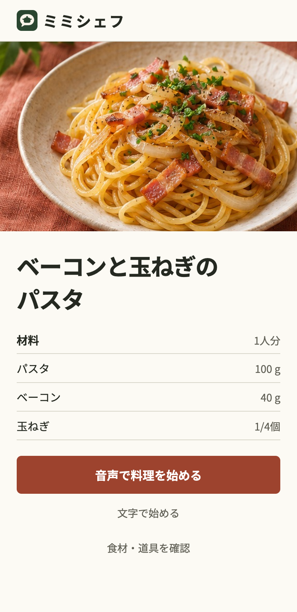

# 【AI HACK 2026】料理の続きを声で案内する「ミミシェフ」を作った

食材を洗って手が濡れているときに、レシピの続きを見たくなる。手を拭いてスマホを開き、さっきまで読んでいた箇所を探す。次の手順を知りたいだけなのに、料理の手が止まります。

AI HACK SPECIAL ONE-DAY HACKATHONで、チーム「ギャップ」は「話すだけで誰かの面倒を減らすアプリ」という課題に取り組みました。私たちが想定したのは、一人暮らしの会社員が自炊で慣れない料理を作る場面です。どこまで作業したかを声で伝えると、次にできる作業を一つ読み上げる料理ガイド「ミミシェフ」を作りました。

## Aqua Voiceをどう使ったか

レシピを選んで会話モードを始めたら、食材を切り終えたときや、火加減を知りたいときに話しかけます。アプリは短い無音を合図に録音を送り、スポンサーツールのAqua Voice APIで文字起こしします。話すたびに送信ボタンを押す手間が省けます。[Aqua Voice APIのドキュメント](https://aquavoice.com/docs/api)

調理状況の判定には、今回は無料で使えたGeminiを選びました。アプリは、文字起こしした内容にレシピと現在の進み具合を添えてGeminiに渡します。Geminiは、どの工程が済んだか、どれがまだか、時間の指定があるかを判定します。

アプリはその判定をもとに、どの工程を次に案内するか、タイマーを始めるかを決めます。「あと何分？」や「火加減は？」には、ブラウザがタイマーやレシピの情報を使って答えます。

## 調理を止めずに使うための工夫

レシピに書かれた順番と実際の作業順が違っても、済んだことをまとめて伝えれば、ミミシェフは次にできる作業を案内します。

タイマーの開始に必要な情報が足りないときは、聞き返します。たとえば、パスタを入れる段階で「7分」とだけ聞こえたら、「パスタはもう入れましたか？」と確認してからタイマーを始めます。

## 調理中の読み上げと画面

案内を読み上げている間は、アプリ自身の声が入力に混ざらないよう、聞き取りを一時停止します。読み上げが終わると自動で再開します。聞きそびれたときは、画面でも次の手順と残り時間を確認できます。




私は主に、調理画面、音声入力と読み上げ、タイマーを担当しました。

## 今後の展望

キッチンや冷蔵庫の中を撮影してもらい、写真から分かる食材や調理器具に合わせて案内できるようにしたいです。たとえば、コンロが一口なら、火を使う工程が重ならないように順番を組み替えて案内します。

## デモを試す

GitHubからリポジトリを取得し、Node.js 22以上で次のコマンドを実行します。[ミミシェフのリポジトリ](https://github.com/bomkim-dev/ai-hack-2026)

```sh
npm start
```

起動後、ブラウザで `http://127.0.0.1:3001/?demo=1` を開くと、APIキーなしで文字入力とタイマーを試せます。

会話モードを使う場合は、READMEに沿ってAqua VoiceとGeminiのAPIキーを設定してください。

参加の機会をつくってくださった運営の皆さま、ありがとうございました。[AI HACK SPECIAL ONE-DAY HACKATHON](https://aihackathon.jp/special/1123/)
